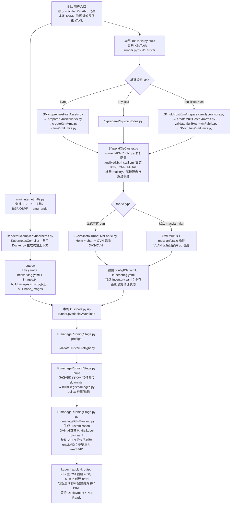
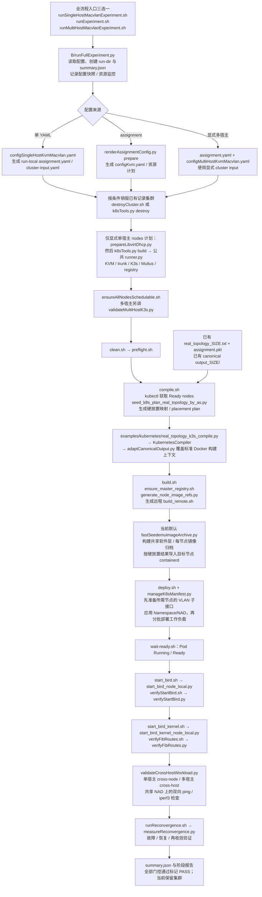

# 0916：B61 / B62 / B63 网络构造、下载依赖与全流程调用链

核对日期：2026-09-16。依据是本工作区**当前文件内容，包括尚未提交的修改**，不是 Git 历史版本。本文进行了静态代码审阅和写入临时目录的编译验证，没有运行集群安装、VM 创建、镜像构建、部署或路由实验。下文路径均相对于仓库根目录。

## 1. 先回答：是不是默认都走 macvlan + VLAN？

**是。当前通用 `KubernetesCompiler()`、B61、B62、B63 的实际入口、源配置和它们共用的真实拓扑编译脚本都默认选择 macvlan + VLAN。** Kube-OVN 仍受支持，但必须由调用方显式指定。

### 1.1 默认值与配置选择对照

| 对象 / 入口 | 当前代码或配置 | 是否 macvlan + VLAN | 依据 |
| --- | --- | --- | --- |
| `KubernetesCompiler()` | `cni_type="macvlan"`、`macvlan_vlan_mode=True`、VLAN 起点 100；通用父接口默认 `eth0` | **是** | [kubernetes.py](seedemu/compiler/kubernetes.py) 的构造函数 |
| `NativeKubernetesCompiler()` | 只是上述类的兼容子类，因此继承同一默认值 | **是** | 同文件末尾的兼容类 |
| B61：`python3 mini_internet_k8s.py` | CLI 默认 `--cni-type macvlan`；VLAN 默认开启，从 100 开始；父接口默认 `ens2` | **是** | [mini_internet_k8s.py](examples/internet/b61_k8s_compile/mini_internet_k8s.py)；只有显式 `--no-macvlan-vlan` 才关闭 VLAN |
| B61：本地 KVM 两份配置 | `kind: kvm`、`fabric.type: macvlan-vlan`，CNI 三项均为 macvlan，父接口 `ens2` | **是** | [简化配置](examples/internet/b61_k8s_compile/configKvmOvnSimply.yaml)、[完整 KVM 配置](examples/internet/b61_k8s_compile/configKvmOvn.yaml) |
| B61：现有物理机配置 | `kind: physical`、`fabric.type: macvlan-vlan`，CNI 三项均为 macvlan，父接口 `ens2` | **是** | [物理机配置](examples/internet/b61_k8s_compile/configK3sOvn.yaml) |
| B61：多宿主 KVM 配置 | `kind: multiHostKvm`、`fabric.type: macvlan-vlan`，VM 内父接口 `ens3`；宿主间用 VXLAN 延伸 VLAN trunk | **是** | [多宿主配置](examples/internet/b61_k8s_compile/configMultiHostKvmOvn.yaml) |
| `examples/kubernetes/real_topology_k3s_compile.py` 未设置相关环境变量 | `SEED_CNI_TYPE` 回落为 `macvlan`；`SEED_MACVLAN_VLAN_MODE` 回落为 true | **是** | [真实拓扑编译脚本](examples/kubernetes/real_topology_k3s_compile.py) |
| B62：`runExperiment.sh` + 当前 `assignment.yaml` | backend/cniType 为 macvlan，VLAN mode 为 true；Python、shell 的缺省回落也已统一 | **是** | [assignment.yaml](largeScale/b62_k8s_scale/assignment.yaml) 及 `runFullExperiment.py`、`renderAssignmentConfig.py`、`lib.sh`、`compile.sh` |
| B62：单宿主 / 多宿主入口 | `fabric.type: macvlan-vlan`，CNI 为 macvlan，配置两条 trunk | **是** | [单宿主配置](largeScale/b62_k8s_scale/configSingleHostKvmMacvlan.yaml)、[多宿主配置](largeScale/b62_k8s_scale/configMultiHostKvmMacvlan.yaml) |
| B63：默认实验、单宿主及 VM 数量矩阵 | 默认清单为 `k8s.yaml`；所有源配置均为 `fabric.type: macvlan-vlan` 和 macvlan CNI | **是** | [默认实验入口](largeScale/b63_deployment/runPlacementExperiment.py)、[单宿主配置](largeScale/b63_deployment/configSingleHostKvmMacvlan.yaml)、[矩阵生成器](largeScale/b63_deployment/generateVmMatrixConfigs.py) |

`kind` 决定“在哪种基础设施上创建集群”，`fabric.type` 决定“采用哪种附加网络”。`kvmOvn / physicalOvn / multiHostKvmOvn` 是历史兼容名称，分别被归一为 `kvm / physical / multiHostKvm`，**不能根据文件名或 kind 中的 Ovn 判断网络类型**。见 [config.py](seedemu/k8sTools/config.py) 的 `normalizeKind()`。

B62 在 `runFullExperiment.py`、`lib.sh` 中把 YAML 转为运行参数，再由 `compile.sh` 显式传入 `SEED_CNI_TYPE`、`SEED_MACVLAN_VLAN_MODE`、`SEED_MACVLAN_VLAN_TRUNKS_JSON` 等。配置值和脚本回落值现在一致，均为 macvlan+VLAN。

### 1.2 两层网络分别做什么

**第一层是 K3s 主网络。** Pod 的 `eth0` 由 K3s/Flannel 提供；管理 IP、API Server、镜像传输也依赖基础网络。B61 没有显式覆盖时，K3s helper 默认 `flannelBackend: host-gw`。当前 B62 单宿主配置显式使用 `vxlan`，旧 assignment 路径配置的是 `host-gw`。

**第二层是 SeedEMU 仿真网络。** Multus 为路由器/主机 Pod 添加 `net1 / net2 / ...`。这里才选择 Kube-OVN 或 macvlan+VLAN。

| 仿真网络模式 | 实际连接关系 | 隔离方式 |
| --- | --- | --- |
| B61 本地 KVM / 物理机默认 | Pod `netN` → macvlan → 节点 `ens2.<VID>` → `ens2` → 底层二层网络 → 对端节点 | 每个 SeedEMU 网络分配一个 VLAN ID；B61 从 100 开始 |
| B61 多宿主 KVM 默认 | Pod `netN` → macvlan → VM `ens3.<VID>` → `ens3` → 宿主专用 libvirt bridge → 宿主间 VXLAN | VLAN 隔离仿真网络；VXLAN 把 trunk 延伸到其他 KVM 宿主 |
| B62 当前单宿主配置 | Pod `netN` → macvlan → VM `ens3.<VID>` 或 `ens4.<VID>` → 独立 trunk NIC → 对应宿主二层桥 → 对端 VM | `(trunk, VLAN ID)` 标识一个仿真二层网络；两条 trunk 分别使用 1–4094 |
| B62 多宿主配置 | 上述 VLAN trunk 再通过宿主间 VXLAN 扩展 | VLAN 负责仿真网络隔离，VXLAN 负责跨物理宿主传输；不是 OVN |
| B63 当前配置 | 与 B62 单宿主路径相同：Pod macvlan 接入 VM 内 VLAN 子接口，再经独立 trunk NIC 接到 libvirt 二层桥 | 源配置和矩阵生成器均显式固定 macvlan+VLAN |

在 `kubernetes.py` 中，`_macvlanVlanAllocation()` 按网络分配 trunk/VID，`_compileNetK8s()` 生成 NAD；macvlan 的 `mode: bridge` 是 **macvlan 自身的模式**，不是选择了 `bridge` CNI。静态仿真地址由编译生成的 `/replace_address.sh` 配置。

编译器只生成接口配置。B61 的 `manageRunningStage.py::prepareMacvlanVlanInterfaces()`、B62 的 `deploy.sh::prepare_vlan_cni_interfaces()` 才会在 K3s 节点上执行 `ip link add ... type vlan id ...`，然后部署 Pod。

注意：B61 本地 KVM/物理机配置**没有** B62 的双 `extraNetworks` 布局，而是复用 `ens2` 的 VLAN 子接口。B61 多宿主配置另设 `ens3` trunk，并由宿主间 VXLAN 承载。相同 VLAN 的跨节点可达性依赖底层二层路径允许带标签帧通过。VLAN ID 也不是按 Kubernetes namespace 自动隔离，多套实验共享同一 trunk 时需协调编号。

### 1.3 B61 默认用法与显式 OVN 兼容用法

以下仅展示调用方式，本次未执行：

```bash
cd examples/internet/b61_k8s_compile

# 默认：macvlan+VLAN 编译 + 本地 KVM 基础设施
python3 mini_internet_k8s.py
python3 k8sTools.py build --input configKvmOvn.yaml \
  --config-k3s configK3s.yaml --kubeconfig kubeconfig.yaml --inventory inventory.yaml
python3 k8sTools.py up -f output -k kubeconfig.yaml -d configK3s.yaml
```

```bash
cd examples/internet/b61_k8s_compile

# 多宿主 KVM：VM 内 trunk 是 ens3，编译时必须与配置一致
python3 mini_internet_k8s.py --cni-master-interface ens3
python3 k8sTools.py build --input configMultiHostKvmOvn.yaml \
  --config-k3s configK3s.yaml --kubeconfig kubeconfig.yaml --inventory inventory.yaml
python3 k8sTools.py up -f output -k kubeconfig.yaml -d configK3s.yaml
```

四份 B61 YAML 的历史文件名仍含 `Ovn`，用于兼容旧命令和外部引用；网络选择以文件内容中的 `fabric.type`/CNI 字段为准。确需测试 Kube-OVN 时，编译端必须显式使用 `--cni-type kube-ovn`，基础设施配置也必须显式改为 OVN，不能只改其中一侧。

## 2. B61 全新运行会下载什么？哪些步骤目前不能直接离线？

这里“全新”指：控制机已取得仓库源码，但没有可复用的 VM 镜像、Docker 镜像、软件包或 Helm 缓存；以本地 KVM 路线为主。下载是否实际发生由缓存、预装软件、基础镜像内容和所选分支决定。

### 2.1 控制机必须先具备的软件

B61 并不是从裸操作系统自动安装全部工具。脚本中的 `requireCommand()` 缺少命令时通常直接报错。

| 位置 | 需要预先具备 | 当前流程是否自动安装 |
| --- | --- | --- |
| 控制机 | Python 3.10+、SeedEMU Python 依赖、Docker、`ansible-playbook`、`kubectl`、SSH/scp/curl 等 | 不统一安装；需要事先准备 |
| 本地 KVM 宿主 | libvirt/KVM、`virsh`、`virt-install`、`qemu-img`、可用的 libvirt 网络 | 不统一安装；`prepareKvmNetworks.py` 可按完整配置创建网络，但 B61 默认依赖已有 `default` 网络 |
| Python 环境 | `setup.py` 声明 `geopy`、`requests`、`PyYAML`；真实拓扑编译脚本另直接导入 `networkx` | `k8sTools.py` 不自动 pip 安装；手动安装时的软件源由 pip 配置决定 |
| OVN 分支控制机 | Helm | 缺失且无缓存时，OVN 安装器会下载私有 Helm 副本 |

不能将这些前置工具的来源说成“B61 会自动从某地址下载”；只有下面实际含 pull/curl/APT 的步骤才是流程自带下载。

### 2.2 VM 镜像：从哪里取，缓存在哪里

实际入口：`runner.py::_buildKvm()` → [prepareHostAssets.py](seedemu/k8sTools/resources/setup/kvm/prepareHostAssets.py)；后续 [createKvmVms.py](seedemu/k8sTools/resources/setup/kvm/createKvmVms.py) 也有下载/复用兜底。

默认操作系统是 **Ubuntu Jammy / 22.04、amd64 cloud image**。默认 URL：

```text
https://cloud-images.ubuntu.com/jammy/current/jammy-server-cloudimg-amd64.img
```

helper 同时支持 `kvm.ubuntuSeries: noble`，对应：

```text
https://cloud-images.ubuntu.com/noble/current/noble-server-cloudimg-amd64.img
```

默认与别名解析见 [manageKvmConfig.py](seedemu/k8sTools/resources/setup/kvm/manageKvmConfig.py) 的 `ubuntu_image_defaults()`、`kvm_env()`。如切换发行版，建议同时显式配套 `baseImagePath/baseImageUrl`，因为外层 `makeKvmConfig()` 的默认文件名仍写为 jammy。

查找顺序如下：

1. 已有 `kvm.baseImagePath`：非空且 `qemu-img info` 成功则直接复用。
2. `kvm.legacyBaseImagePath` 指向的已有文件：复制或复用；完整 `configKvmOvn.yaml` 将它置空，禁用这一分支。
3. 在 `kvm.baseImageSearchDirs` 中按目标文件名查找可复用文件。
4. 都没有时，`curl -fL` 下载 `kvm.baseImageUrl`，使用 `.part` 文件续传，下载后检查镜像再发布最终文件。

通过 `k8sTools.py build` 运行时，外层默认持久路径不是示例目录：`config.py::_defaultKvmDataDir()` 分配 `/data/<执行用户>/k8sTools/<临时工作目录名>-<摘要>/base/jammy-server-cloudimg-amd64.img`，VM 差分盘在同一数据目录的 `disks/`。每次临时目录不同，默认路径也可能不同；想稳定复用应配置固定 `kvm.baseImagePath`。

VM 磁盘用 `qemu-img create -b <base-image>` 创建 qcow2 差分盘，再由 `virt-install` 启动。这是通用 Ubuntu 镜像，**不预装本项目所需 K3s**。默认云镜像 URL 含 `current`，版本也未用摘要固定。

### 2.3 从零构建的联网清单

| 阶段 / 执行位置 | 下载或安装对象 | 地址 / 来源 | 缓存与当前离线能力 | 代码依据 |
| --- | --- | --- | --- | --- |
| 准备 VM / 控制机 | Ubuntu cloud image | 上述 `cloud-images.ubuntu.com` | 支持本地 qcow2 复用；无缓存时下载 | `kvm/prepareHostAssets.py`、`kvm/createKvmVms.py` |
| VM 首次启动 / 每台 VM | APT 索引、`qemu-guest-agent` 及依赖 | 云镜像内部 APT sources；实际镜像站由镜像和环境决定 | cloud-init 固定写 `package_update: true`，不能仅靠准备 qcow2 就保证无外网请求 | `createKvmVms.py::createVmCloudInit()` |
| 准备构建基础镜像 / 控制机 | `ubuntu:20.04` | Docker Hub；失败时尝试 `docker.m.daocloud.io/library/ubuntu:20.04` | Docker daemon 已有该 tag 时可跳过 pull | `prepareHostAssets.py`、`applyK3sCluster.py` |
| 准备 SeedEMU multiarch 基础镜像 / 控制机 | `handsonsecurity/seedemu-multiarch-base:buildx-latest`、`handsonsecurity/seedemu-multiarch-router:buildx-latest` | 本地 `docker_images/multiarch` Dockerfile 构建；prepare 阶段找不到目录时可尝试 Docker Hub/DaoCloud | 已有 Docker tag 可复用；本地 build 中的 APT 仍会联网；apply 阶段还要求本地源码目录存在 | 两个 setup 入口；`docker_images/multiarch/*/Dockerfile` |
| bootstrap / 控制机 | `registry:2` | Docker Hub，失败回退 `docker.m.daocloud.io/library/registry:2` | 保存 tar，再传到 master Docker；不是让所有 VM 逐个拉公网 registry 镜像 | `prepareHostAssets.py`、`applyK3sCluster.py` |
| Multus / 控制机 | `ghcr.io/k8snetworkplumbingwg/multus-cni:snapshot` | **GHCR：`ghcr.io`** | 可预装到控制机 Docker，再导入节点 containerd；现有 Docker Hub 回退函数不覆盖该 GHCR 地址 | 同上；`ansible/k3s-install.yml` |
| K3s 系统镜像缓存 / 控制机 | `rancher/mirrored-coredns-coredns:1.10.1`、`rancher/mirrored-metrics-server:v0.6.3`、`rancher/local-path-provisioner:v0.0.24` | Docker Hub，失败回退 DaoCloud 对应路径 | 脚本硬编码这三个 tag，导入每台节点；它们不是按 K3s 版本解析得到的完整离线镜像清单 | `K3S_SYSTEM_BOOTSTRAP_IMAGES` |
| master 软件安装 / master VM | `docker.io` 及依赖 | master 的 APT sources | 检查不到 Docker 时安装；没有本地 deb 包安装分支 | `ansible/k3s-install.yml` 第 75 行附近 |
| K3s 安装 / master 与 worker VM | 安装 shell 脚本 | **`https://get.k3s.io`** | master/worker 均在线 curl；worker 跳过二进制下载不等于跳过脚本下载 | 同 playbook 第 128、590 行附近 |
| K3s 安装 / master VM | K3s 二进制、校验和 | 默认 artifact 前缀 **`https://rancher-mirror.rancher.cn/k3s`** | 当前 master 安装路径没有接入本地 K3s binary/install.sh 的完整离线分支 | `manageK3sConfig.py::installVersion()`、playbook |
| CNI 插件 / 每台 VM | `containernetworking-plugins` | 每台 VM 的 APT sources | 若 dpkg 已安装则跳过；否则 apt update/install；随后链接 macvlan、ipvlan、static 到 `/opt/cni/bin` | playbook 第 149、602 行附近 |
| 构建工具 / master VM | `docker-buildx` | master 的 APT sources | buildx 检查失败时自动 apt 安装 | `applyK3sCluster.py::ensureRegistry()` |
| 仅 OVN / 控制机 | Helm `v3.15.4` amd64 | `https://get.helm.sh/helm-v3.15.4-linux-amd64.tar.gz` | 可复用系统 Helm、私有缓存二进制或下载包 | `ovn/installKubeOvnFabric.py::ensureHelm()` |
| 仅 OVN / 控制机 | Kube-OVN Helm chart，默认 `v1.15.12` | `https://kubeovn.github.io/kube-ovn/`；`helm repo update` + `helm pull`，实际 tar URL 由 index 决定 | 支持 `ovn.helmCacheDir/charts/` 中的本地 tgz | 同文件 `ensureKubeOvnChart()` |
| 仅 OVN / 控制机 → 各 VM | 默认 `docker.io/kubeovn/kube-ovn:v1.15.12` | Docker Hub；回退 `docker.m.daocloud.io/kubeovn/kube-ovn:v1.15.12` | 支持 OVN 镜像 tar 缓存，再导入各节点 containerd | 同文件 `preloadKubeOvnImage()` |
| `up` 基础镜像预处理 / 控制机 → master | 扫描输出 Dockerfile 的外部 FROM，如 `handsonsecurity/seedemu-base:2.0`、`handsonsecurity/seedemu-router:2.0`、`ubuntu:24.04` | Docker Hub/DaoCloud；实际集合由编译结果决定 | 先确保控制机 Docker 有镜像，再 `docker save` / SSH / `docker load` 到 master | `running/manageRunningStage.py::ensureBuildBaseImages()` |
| `up` 镜像构建 / master | Dockerfile 中缺失的软件及本地基础镜像构建依赖 | APT sources；非 multiarch router Dockerfile 还调用 `add-apt-repository ppa:cz.nic-labs/bird`，涉及 Launchpad PPA | 有 FROM 镜像并不代表后续 `RUN apt-get` 离线；需完整构建缓存/预构建镜像/可达软件源 | `running/buildRegistryImages.py`、`compiler/Docker.py::_computeDockerfile()` |
| 工作负载分发 / 各 VM | 构建好的 SeedEMU 节点镜像 | **master 的局域网 registry，默认端口 5000** | 这是内网传输；B61 默认 `imagePullPolicy: Always` 仍需要 registry 可达 | `runner.py::deployWorkload()`、`manageK8sManifest.py` |

基础镜像中的软件列表也要算在“从零构建”的下载内：multiarch base 安装 `curl dnsutils ipcalc iproute2 iputils-ping jq mtr-tiny nano netcat tcpdump termshark vim-nox zsh`，router 安装 `bird2`。非 multiarch base 使用 Ubuntu 24.04，并将 netcat 换为 `netcat-openbsd`；其 router 额外安装 `software-properties-common gpg-agent` 并添加 BIRD PPA。传递依赖由 APT 决定，仓库代码没有锁定完整包版本列表。

**setup 的 multiarch 镜像缓存，不等于 B61 编译输出需要的 `:2.0` 镜像缓存。** 当前默认 amd64 镜像映射见 [DockerImageConstant.py](seedemu/compiler/DockerImageConstant.py)；因此不能只准备一套名字相似的镜像就认定 `up` 无需下载。

### 2.4 K3s 的准确安装过程和版本

| B61 配置 | 未自行指定版本时的实际版本 | 原因 |
| --- | --- | --- |
| `configKvmOvnSimply.yaml`、`configKvmOvn.yaml`、`configK3sOvn.yaml`、`configMultiHostKvmOvn.yaml` | `v1.29.15+k3s1` | 四份源配置均显式固定该版本，不再依赖某种 fabric 的隐式版本注入 |

安装顺序：

1. 控制机运行 `applyK3sCluster.py`，生成 Ansible inventory，执行仓库内的 `ansible/k3s-install.yml`。
2. master 执行 `curl -sfL https://get.k3s.io | INSTALL_K3S_VERSION=... INSTALL_K3S_ARTIFACT_URL=... sh -`。
3. 本项目识别 Rancher 中国镜像前缀时，把版本字符串的 `+` 换为 `-`；上述配置传给镜像站的版本路径是 `v1.29.15-k3s1`。
4. 按核对时的官方安装脚本，amd64 下载地址由前缀、版本、文件名拼接；对应本配置预期请求如下，**本次未验证镜像站文件下载成功**：

   ```text
   https://rancher-mirror.rancher.cn/k3s/v1.29.15-k3s1/sha256sum-amd64.txt
   https://rancher-mirror.rancher.cn/k3s/v1.29.15-k3s1/k3s
   ```

   官方脚本默认 artifact 源是 GitHub Releases，但本项目显式覆盖为 Rancher 中国镜像；地址拼接逻辑见 [官方安装脚本](https://get.k3s.io)。
5. Ansible 从 master 抓取 `/usr/local/bin/k3s` 到控制机 `/tmp/seedemu-k3s-binary-<installVersion>/k3s`，再复制到 worker。
6. worker 仍 curl 同一个在线安装脚本，仅设置 `INSTALL_K3S_SKIP_DOWNLOAD=true` 跳过二进制/校验和下载，然后连接 master API 加入集群。

K3s 版本被指定，但 `get.k3s.io` 的脚本内容没有在仓库中固定。K3s 运行所需镜像也不能只看上表三个 bootstrap tag：当前 B61 固定为 1.29.15，而硬编码旧 tag 未覆盖该版本的实际组件；sandbox/pause 等也不在该三个元素数组中。节点可能继续通过配置的 registry mirror 或公网源拉取缺失镜像。**这里是根据预加载清单和安装顺序识别的离线缺口，不是一次抓包得到的完整流量清单。**

### 2.5 为什么已有缓存或 `seedemu.offline: true` 仍不能保证离线

| 机制 | 当前代码的实际行为 |
| --- | --- |
| VM qcow2 本地复用 | 已有支持；但新 VM 的 cloud-init 仍配置 APT 更新/guest-agent 安装 |
| `kvm.prepareImageCache: false` | 只跳过 `prepareHostAssets.py` 的镜像缓存准备；后面的 `applyK3sCluster.py` 仍会准备镜像，并不关闭下载 |
| `seedemu.hostImageCacheDir` | helper 输出为 `seedemuHostImageCacheDir`，但当前 `applyK3sCluster.py` 没有把它赋给实际使用的 `HOST_IMAGE_CACHE_DIR`；后者仍是 `${SCRIPT_DIR}/image-cache`。`prepareHostAssets.py` 也使用其自身脚本目录下的 image-cache。**不能保证填写这个 YAML 字段就改变了实际缓存目录** |
| 普通镜像 tar 复用 | `applyK3sCluster.py::saveHostImageTarball()` **先确保 Docker daemon 中有镜像，再检查 tar 是否存在**。仅拷入 tar、未 `docker load`，仍可能触发 pull；而 `prepareHostAssets.py` 的检查顺序不同，先检查 tar |
| `seedemu.imageCacheDirs` | helper 解析并输出该字段，但在本次检查的 setup 消费脚本中未发现遍历它并导入普通镜像的实现；不能把“配置中能填写”当成“缓存已加载” |
| `seedemu.offline` | OVN 安装器检查它，缺少 Helm/chart/OVN 镜像缓存时拒绝下载；通用 K3s playbook 的 curl/APT、普通 Docker pull/build 路径没有完整对应门控 |
| setup 临时资源 | `runner.py` 默认复制到临时目录，结束删除；当前普通镜像缓存跟随各脚本临时目录，Helm 缓存未配置持久 `ovn.helmCacheDir` 时也跟随临时目录。`--keep-temp` 可保留这一轮临时目录，但不会自动让下一轮复用它；KVM 持久数据目录另算 |
| 完整 K3s air-gap 镜像包 | 当前 B61 自动流程没有下载/预置完整 `k3s-airgap-images-*.tar.*` 的步骤 |

所以更准确的说法是：**当前 B61 自动化尚未打通端到端离线安装；这些软件本身并非不能离线安装。** K3s 官方离线方案支持预置二进制、`install.sh` 和匹配版本的镜像包，然后跳过下载；见 [K3s Air-Gap Install](https://docs.k3s.io/installation/airgap)。若要把 B61 改成完整离线，需要另外接入本地安装脚本/二进制、完整运行镜像、预装系统包或离线 APT 源，以及 Dockerfile 构建依赖。本次只指出缺口，没有修改安装流程。

还有一个本地路径前提：setup 复制进临时目录后，查找 `docker_images/multiarch` 会依赖 `seedemu.dockerImagesDir` 与 helper 的候选源码路径；不能保证自动找到当前 checkout。B61 YAML 未指定这个字段。换到全新机器时应核对它指向的本地源码目录；否则 apply 阶段可能在构建镜像前就因目录不存在而失败。

## 3. 流程图一：B61 从拓扑到可运行仿真网络

图中 `S/` = `seedemu/k8sTools/resources/setup/`，`R/` = `seedemu/k8sTools/resources/running/`。B61 当前没有单独的一键全流程 shell；用户依次执行 compile、build、up。



### 3.1 B61 逐层脚本及产物

| 层级 / 阶段 | 全流程入口调用的脚本、库 | 输入 → 输出 / 作用 |
| --- | --- | --- |
| 拓扑入口 | [mini_internet_k8s.py](examples/internet/b61_k8s_compile/mini_internet_k8s.py) → SeedEMU layers/Makers → `KubernetesCompiler` | 脚本内拓扑 → Kubernetes 清单、构建上下文；不需要 live cluster inventory |
| CLI 包装 | [本例 k8sTools.py](examples/internet/b61_k8s_compile/k8sTools.py) → [公共 k8sTools.py](seedemu/k8sTools/k8sTools.py) → [runner.py](seedemu/k8sTools/runner.py) | 用户命令 → `buildCluster/deployWorkload/cleanWorkload/destroyCluster` |
| 配置和资源展开 | [config.py](seedemu/k8sTools/config.py)、[utils.py](seedemu/k8sTools/utils.py)、`setup/normalizeResources.py` | 归一 kind/资源/路径，复制内部 setup/running 到临时目录 |
| 单宿主 KVM | `S/kvm/prepareHostAssets.py` → `prepareKvmNetworks.py` → `createKvmVms.py` → `tuneVmLimits.py` | 云镜像/容器缓存 → 管理及可选 trunk 网络 → VM/差分盘/cloud-init → 系统限制调优 |
| KVM 解析 helper | `S/kvm/manageKvmConfig.py` | 解析 YAML、节点计划、VM IP/MAC、下载路径，生成 K3s 配置和 KVM state；被多个 KVM 入口调用 |
| 多宿主替代分支 | `S/multiHostKvm/prepareKvmHypervisors.py` → `createMultiHostKvmVms.py` → `validateMultiHostKvmFabric.py` → `S/kvm/tuneVmLimits.py` | 每台宿主的 libvirt 网络/路由/VM；VLAN fabric 下增加跨宿主 VXLAN trunk 与 VLAN 探针验证 |
| 多宿主 helper | `S/multiHostKvm/manageMultiHostKvmConfig.py`；多宿主创建流程复用 KVM 入口 | 多宿主 YAML → 分宿主 KVM 配置及全局 state |
| 现有机器替代分支 | `S/preparePhysicalNodes.py` | SSH、sudo、基础命令检查；不创建 VM，不下载 VM cloud image |
| 安装公共集群 | `S/applyK3sCluster.py` → `S/manageK3sConfig.py` → `S/ansible/k3s-install.yml` | SSH/Ansible 安装 K3s、Multus、插件；配置 master registry、导入镜像、生成 kubeconfig/inventory |
| OVN 条件分支 | `S/ovn/installKubeOvnFabric.py` → Helm/容器工具 | 安装 secondary Kube-OVN/OVS；macvlan 配置跳过 |
| running 总控 | `R/manageRunningStage.py` 依次执行 `preflight`、`build`、`up` | output + configK3s + kubeconfig → 已部署仿真 |
| running 子脚本 | `R/validateClusterPreflight.py`、`R/buildRegistryImages.py`、`R/manageK8sManifest.py` | 预检查；构建/推送；解析镜像与 NAD、渲染 OVN/kustomization、识别 VLAN 接口 |
| shell 适配层 | setup、kvm、multiHostKvm、ovn、running 中的 `_embeddedShell.py` | 部分 `.py` 入口内实际保存 shell 正文，由该 helper 执行；不能只检查 `.sh` 文件来统计下载行为 |
| 编译生成的脚本 | `output/build_images.sh`，节点镜像中的 `/start.sh`、`/replace_address.sh` | 前者是另一种镜像构建入口，**B61 `k8sTools up` 的默认实际构建器是 `buildRegistryImages.py`**；后两者用于容器启动和接口配置 |
| workload 清理 | `k8sTools.py clean/down` → `runner.py::cleanWorkload()` | 删除工作负载，保留集群 |
| 基础设施销毁 | `k8sTools.py destroy` → `S/destroyPhysicalCluster.py`，再按 kind 调 `S/kvm/destroyKvmVms.py` 或 `S/multiHostKvm/destroyMultiHostKvmVms.py` | 清理 K3s/fabric，再清理已记录的 KVM 资源；destroy state 嵌入 `configK3s.yaml` |

`ovn/validateKubeOvnFabric.py`、`vxlan/configureLinuxVxlanFabric.py`、`vxlan/validateLinuxVxlanFabric.py` 是资源目录中的独立工具；不能仅因它们存在，就把它们画成上述 B61 默认 build 的必经子调用。多宿主 KVM 的 VXLAN trunk 由其自身 preparation 实现。

## 4. 流程图二：B62 从集群、拓扑到路由与数据面验证

以下 `B/` = `largeScale/b62_k8s_scale/`。图覆盖三个全流程入口；公共 KVM/K3s setup 的内部步骤与上图相同。



### 4.1 三个全流程入口的区别

| 入口 | 调用关系 | 当前文件中的实际规模与配置 |
| --- | --- | --- |
| [runSingleHostMacvlanExperiment.sh](largeScale/b62_k8s_scale/runSingleHostMacvlanExperiment.sh) | `runFullExperiment.py --config configSingleHostKvmMacvlan.yaml` | 当前 `topologySize: 7001`、47 workers + 1 master = **48 VM**；clusterName 中的 w5 是旧命名，不能据此推断 VM 数量 |
| [runExperiment.sh](largeScale/b62_k8s_scale/runExperiment.sh) | 直接转发参数到 `runFullExperiment.py`；默认 assignment 路径 | 当前 assignment 是 `topologySize: 1078`、5 workers + 1 master = **6 VM**；渲染 KVM 配置后走公共流程 |
| [runMultiHostMacvlanExperiment.sh](largeScale/b62_k8s_scale/runMultiHostMacvlanExperiment.sh) | `runFullExperiment.py --assignment assignment.yaml --cluster-config configMultiHostKvmMacvlan.yaml` | 当前两台 hypervisor 的 `vmCount` 为 24 和 6，总计 **30 VM**；拓扑规模仍读当前 assignment，即 **1078**。wrapper 注释/默认目录名中的 4954 不会改写 topologySize |

这一对照只是当前文件快照，不表示正在运行的集群一定具有这些规模。`--prepare-only` 只生成配置快照；resume 可以从 build/start-kernel/reconvergence 恢复，因此恢复运行不会重走图中全部节点。

### 4.2 B62 全流程脚本及其子调用清单

| 阶段 | 直接调用 | 进一步调用 / 关键操作与产物 |
| --- | --- | --- |
| 总控 | `runFullExperiment.py` | 配置适配、`normalizeResources.py` 资源单位归一；`performanceMetrics.py` 导入仓库外同级 `../multihost/performanceMetrics.py` 的公共采样实现；阶段日志、summary、资源采样 |
| assignment 渲染 | `renderAssignmentConfig.py prepare` | 仅 assignment-only 路径调用；单 YAML 用总控内部适配函数，显式 cluster-config 直接复制配置 |
| 旧集群清理 | `destroyCluster.sh` 或 `k8sTools.py destroy` | 前者最终也调用公共 destroy；显式 cluster input 走后者；无记录则跳过，`--skip-existing-destroy` 可跳过 |
| DHCP | `prepareLibvirtDhcp.py` | 总控仅在单宿主配置含显式 `nodes[]` 时调用；compact master/workers 计划由 `createKvmVms.py` 自己预留地址 |
| 新建集群 | `B/k8sTools.py build` | → `seedemu.k8sTools.K8sTools` → `runner.py` → 上图所列 setup 脚本；输出 configK3s/kubeconfig/inventory |
| 调度与跨宿主主网络检查 | `ensureAllNodesSchedulable.sh`；条件调用 `validateMultiHostK3s.py` | 允许 master/worker 调度；多宿主创建临时定点 Pod，验证 Flannel Pod-IP 双向连通 |
| 清理、前检 | `clean.sh` → `preflight.sh` | 通过 `lib.sh` 解析 run 配置；检查节点、registry、kube-system、拓扑输入和 namespace；只有 OVN 模式才清理 OVN 对象 |
| 放置计划 | `compile.sh` → `lib.sh::generate_as_placement_plan()` → `seed_k8s_plan_real_topology_by_as.py` | 读取拓扑、assignment.pkl、Ready nodes；生成 `placement_expected.json` / `placement_plan.json`，采用 `by_as_hard` |
| 拓扑编译 | `compile.sh` → `examples/kubernetes/real_topology_k3s_compile.py` → `KubernetesCompiler` | 传入 CNI/VLAN/MTU/namespace/registry/硬放置参数；写本轮 output；镜像策略设 `IfNotPresent` |
| 对齐标准构建上下文 | `compile.sh` → `adaptCanonicalOutput.py` | 读取已有 canonical DockerCompiler output，校验节点/地址，将其 BIRD/启动/镜像上下文同步到本轮 output，保留 K8s 地址替换 hook |
| registry 与节点镜像列表 | `build.sh` → `ensure_master_registry.sh`、`generate_node_image_refs.py` | 根据清单 nodeSelector 生成每节点镜像列表；上传构建内容和 helper 到 master |
| 构建与分发 | `build.sh` → 临时生成的 `build_remote.sh` → **`fastSeedemuImageArchive.py`** | 当前 `SEED_FAST_IMAGE_ARCHIVE=1`；生成 Docker 兼容归档，通过 SSH/scp/流式传输导入目标节点 containerd；普通 `output/build_images.sh` 是关闭 fast 分支后的替代路径 |
| 清单和部署 | `deploy.sh` → 公共 `resources/running/manageK8sManifest.py` | 通过 `lib.sh` helper 解析/转换清单；计算每节点 VLAN 需求，创建 VLAN parents；静态对象和工作负载分批应用、检查压力 |
| Ready | `wait-ready.sh` | 等待 Pod Running/Ready；此时不等于路由已经收敛 |
| 启动 BIRD | `start_bird.sh` → `start_bird_node_local.py` | SSH 到各节点，通过节点本地 CRI/nsenter 启动路由器进程，减少大量 kubectl exec 开销 |
| BIRD 检查 | `verifyStartBird.sh` → `verifyStartBird.py` | 等待负载门控满足，再对确定性样本检查 BIRD 协议；结果写 JSON |
| 开启内核导出 | `start_bird_kernel.sh` → `start_bird_kernel_node_local.py` | 更新/reload BIRD kernel export，使 RIB 路由进入 Linux FIB |
| FIB 检查 | `verifyFibRoutes.sh` → `verifyFibRoutes.py` | 负载门控 + 确定性路由样本验证，输出 FIB summary |
| 数据面 | `validateCrossHostWorkload.py` | 总控对 KVM 路径调用；单宿主选 cross-node，多宿主选 cross-host；不是只检查 Pod Ready |
| 再收敛 | `runReconvergence.sh` → `measureReconvergence.py` | 故障/恢复、协议和路由数量观测，生成 reconvergence summary |
| 总结 | `runFullExperiment.py` | 检查阶段退出码、汇总指标与 JSON；失败中止，全部通过才 PASS |

补充边界：

- `lib.sh` 是多个阶段共同 `source` 的配置、路径、SSH、清单与放置 helper；`run_in_seedpy310` 使用本机现有 Python/Conda 环境，不会自动下载拓扑数据或创建完整研究环境。
- B62 **依赖已有** `real_topology_<SIZE>.txt`、`assignment.pkl` 和 `<topologyDir>/output_<SIZE>/`（或显式 `experiment.canonicalOutputDir`）。`compile.sh` 找不到 canonical output 会失败，并不会自动调用另一个 DockerCompiler 工作流补生成。
- `buildCluster.sh` 是手动“仅建集群”的独立入口：`renderAssignmentConfig.py` → `prepareLibvirtDhcp.py` → `k8sTools.py build`。**全流程总控调用自身 `buildCluster()`，不调用这个 shell**。
- `runMultiVmMacvlanVlanSweep.py` 是批量 VM 数量实验入口；`compareVlanCniObservability.py` 是手动网络观测工具，不是单次默认主链。
- `start_bird.sh` 和 `start_bird_kernel.sh` 还有 `runDockerBirdStage.py` 的 Docker 兼容分支；上图表达的是 Kubernetes 正常路径。
- 当前 `runFullExperiment.py` 末尾将 `runBgpTest()` 和 `destroyAfterPass()` 的调用注释掉了，所以 **`test.py` 不在默认主链，成功后也不自动销毁集群**。`runExperiment.sh` 头部“成功后销毁”的旧注释与实际执行代码不同。

## 5. README 与当前实现的对应关系

| 检查项 | 当前实现 |
| --- | --- |
| B61 默认网络 | README、无参数编译入口和四份源配置现已统一为 macvlan+VLAN；多宿主编译需把父接口指定为 `ens3` |
| 历史文件名带 `Ovn` | 为避免破坏旧命令仍保留文件名；文件内 `kind`、`fabric.type` 和 CNI 字段才是当前有效设置 |
| README / 文件头说编译直接生成 `k8s.kube-ovn.yaml`、`images.yaml` | 当前 `KubernetesCompiler::_doCompile()` 直接写 **`k8s.yaml`、`images.txt`、`networking.yaml`**；running 的 `manageK8sManifest.py` 才按 OVN 后端转换并添加 Vpc/Subnet。工具兼容读 images.yaml，但不代表本版编译器一定生成它 |
| B61 打印 image prefix 为 seedemu | 本例没有向构造函数传 registry_prefix，当前构造默认是 **`localhost:5000`**；`up` 从实际 images 元数据推断逻辑 prefix，再映射到 master registry |
| worker 任务名含 offline | 只离线复制 K3s 二进制；安装 shell 仍在线 curl，CNI 软件包仍可能 APT 下载 |
| 有 image-cache 目录就等于能离线 build | 还需 Docker daemon 对应 tag、K3s 完整运行镜像、安装脚本、APT/构建依赖；普通 tar 检查顺序也存在限制 |
| B62 名字里 w5 / 4954 表示实际规模 | 要读当前 YAML 的 workers/vmCount/topologySize；名字和旧注释不参与规模计算 |
| B62 全流程一定调用 output/build_images.sh，并在成功后销毁 | 当前默认走 fast archive；自动销毁已注释 |

## 6. 本次核查与验证记录

- 范围：指定 compiler、k8sTools、B61、真实拓扑编译脚本、B62、B63；追查它们直接依赖的 Dockerfile、Docker 编译器、Routing 层和公共 helper。
- 命令：`git status --short` 确认已有用户修改；`rg --files` 枚举文件；`rg -n` 检索 CNI/VLAN 默认值、子调用、URL、pull/curl/APT/离线开关；`cat`、`sed -n` 阅读对应实现；使用 `apply_patch` 更新代码、配置与本文。
- 外部只读核对：打开官方 `get.k3s.io` 安装脚本和 K3s air-gap 文档，确认 artifact 拼接与官方离线安装能力；未执行下载到的脚本。
- 验证：B61 无参数编译和多宿主 `ens3` 编译均写入 `/tmp`；两份产物各有 29 个 macvlan NAD、29 个 VLAN，VLAN 从 100 开始。另验证通用 `KubernetesCompiler()` 无网络参数时生成 macvlan+VLAN；解析 15 份 YAML；验证 B62 缺失 `networking` 段时仍回落到 macvlan+VLAN；验证 B63 五份矩阵配置与生成器一致；运行 Python/shell 语法检查及 Kubernetes 编译器相关单元测试。具体结果同步记录在根目录工作日志。
- 未执行：build/up/destroy、APT/pip 安装、Docker pull/build/push、VM/集群操作、BIRD/FIB/再收敛实验。下载清单不等同于一次实际运行的联网日志；没有宣称远程镜像源均可用。

## 7. B61 下载物总表，以及 master / worker 的分别需求

本节专门回答两个问题：SeedEMU multiarch 基础镜像是否必要，以及从一台全新的机器开始准备 B61 时，应当下载哪些通用文件、master 需要哪些镜像和软件、worker 又需要哪些。

### 7.1 SeedEMU multiarch 基础镜像对当前 B61 是否必要

结论分成“功能需求”和“当前代码行为”两层：

- **从当前 B61 工作负载的功能需求看，不必要。** B61 默认 `--platform amd64`，编译器从 `DockerImageConstant.py` 选择 `handsonsecurity/seedemu-base:2.0` 和 `handsonsecurity/seedemu-router:2.0`，没有选择 `handsonsecurity/seedemu-multiarch-*`。
- **从当前 `k8sTools.py build` 能否顺利执行看，暂时仍被代码强制要求。** `prepareHostAssets.py` 和 `applyK3sCluster.py` 都无条件准备 multiarch base/router；后者还无条件要求本地存在 `docker_images/multiarch/seedemu-base` 和 `seedemu-router`。仅删除镜像或目录会让现有 build 失败。
- 因此正确优化方式应是让 setup 按编译产物或显式需求条件化准备镜像，而不是手工删掉镜像后继续用旧脚本。本文没有修改这段代码。

精确对应关系如下：

| setup 预先准备的镜像 | setup 写死的 MD5 标签 | 当前 B61 实际基础镜像 | B61 实际 MD5 标签 | 是否对应 |
| --- | --- | --- | --- | --- |
| `handsonsecurity/seedemu-multiarch-base:buildx-latest` | `98a2693c996c2294358552f48373498d` | `handsonsecurity/seedemu-base:2.0` | `ad739b7b201eccafa592110d2bf214a7` | 否 |
| `handsonsecurity/seedemu-multiarch-router:buildx-latest` | `39e016aa9e819f203ebc1809245a5818` | `handsonsecurity/seedemu-router:2.0` | `072d7840db6a44d06e5c5fd4d7ea8a7d` | 否 |

当前流程准备 multiarch 镜像的原始意图，是给使用这些镜像名的旧编译产物、多平台示例或其他服务提供构建基础，并提前在 master Docker 中建立稳定的 MD5 标签。仓库其他示例和测试确实还引用它们，所以不能据此认定这两个镜像在整个仓库都无用；这里只能判定它们对**当前 B61 编译产物**没有被消费。

当前 B61 已有另一条更准确的基础镜像链：

1. `KubernetesCompiler` 记录本次实际使用的 `base:2.0` 和 `router:2.0`。
2. 编译器把对应本地 Dockerfile 复制进 `output/base_images/<实际 MD5>/`。
3. `k8sTools up` 扫描这些 Dockerfile，准备真正的外部 `FROM`，然后在 master 上构建实际哈希基础镜像和每个节点镜像。

因此建议的后续代码方向是：setup 只负责 K3s、registry 和 CNI；SeedEMU 工作负载基础镜像完全由 compile output + `up` 驱动。这样可以删除 B61 中 multiarch 的重复构建、传输和 push，同时不会猜测工作负载用的是哪一种基础镜像。该建议尚未实施，也应先检查 B62 的 canonical output 和仓库中显式使用 multiarch 的其他例子。

### 7.2 “下载”与“节点最终需要持有”要分开看

当前实现尽量由控制机下载一次，再复制或导入到节点，所以某个镜像出现在 worker containerd 中，不代表 worker 直接访问过公网。

| 标记 | 含义 |
| --- | --- |
| 公网下载 | 该机器通过 curl、APT、Docker/containerd 直接访问外部站点 |
| 控制机预取 | 控制机下载/构建后，用 tar + SSH/scp 导入 master 或 worker |
| 内网拉取 | 节点从 master 上的 `http://<master-ip>:5000` registry 拉工作负载镜像 |
| 最终持有 | 该文件或镜像必须存在于目标节点，但来源可以是公网、缓存、控制机预取或内网 registry |

### 7.3 通用预下载清单：建议在联网机器一次准备

以下表格是制作离线包时最实用的总入口。KVM 路线需要全部相关项；已有物理机路线不需要 Ubuntu cloud image 和 `qemu-guest-agent`。

| 类别 | 建议准备的文件 / 镜像 | 默认来源 | 使用者 / 条件 |
| --- | --- | --- | --- |
| VM 操作系统 | `jammy-server-cloudimg-amd64.img` | `https://cloud-images.ubuntu.com/jammy/current/jammy-server-cloudimg-amd64.img` | KVM hypervisor 使用一次，master/worker 都从它创建 qcow2 差分盘 |
| K3s 安装脚本 | 固定保存一份 `install.sh` | `https://get.k3s.io` | 当前代码却由 master 和每个 worker 分别在线 curl；完整离线时应改为分发本地副本 |
| K3s server 二进制与校验和 | `v1.29.15+k3s1` 的 `k3s`、`sha256sum-amd64.txt` | 当前项目配置前缀是 `https://rancher-mirror.rancher.cn/k3s`；官方等价版本在 K3s GitHub Release | 四份 B61 配置一致；master 使用，worker 当前从 master 复制同一个二进制 |
| K3s 完整运行镜像 | `k3s-airgap-images-amd64.tar.zst`，版本必须是 `v1.29.15+k3s1` | `https://github.com/k3s-io/k3s/releases/download/v1.29.15%2Bk3s1/k3s-airgap-images-amd64.tar.zst` | 建议放进每台 K3s 节点的 `/var/lib/rancher/k3s/agent/images/` |
| Linux CNI 可执行文件 | Ubuntu 包 `containernetworking-plugins` 及其 deb 依赖 | 每台 VM 的 Ubuntu APT sources | master 和所有 worker；提供 `macvlan`、`ipvlan`、`static` 等二进制 |
| Multus | `ghcr.io/k8snetworkplumbingwg/multus-cni:snapshot` | GHCR | master 和所有 worker 的 containerd 最终都需要；当前由控制机 Docker 预取并导入 |
| 本地 registry | `registry:2` | Docker Hub；当前 Docker Hub 失败时尝试 DaoCloud mirror | 只在 master Docker 中运行 |
| Kube-OVN 镜像 | `docker.io/kubeovn/kube-ovn:v1.15.12` | Docker Hub；回退 `docker.m.daocloud.io/kubeovn/kube-ovn:v1.15.12` | B61 默认不需要；仅显式改用 Kube-OVN 时导入所有 K3s 节点 containerd |
| Kube-OVN 工具 | Helm `v3.15.4`、Kube-OVN chart `v1.15.12` | `https://get.helm.sh/helm-v3.15.4-linux-amd64.tar.gz`、`https://kubeovn.github.io/kube-ovn/` | B61 默认不需要；显式 OVN 路径只在控制机使用 Helm |
| B61 工作负载基础 | `ubuntu:24.04`、`handsonsecurity/seedemu-base:2.0`；其余内容可从仓库的 `docker_images/seedemu-*` Dockerfile 构建 | Docker Hub/DaoCloud 或本地预存 | `up` 的 master Docker 构建流程使用；当前扫描逻辑会确保这两个外部 `FROM` 可用 |
| 当前 setup 的额外兼容项 | `ubuntu:20.04`、两个 `handsonsecurity/seedemu-multiarch-*:buildx-latest` | Docker Hub/DaoCloud，或仓库 `docker_images/multiarch/` 本地构建 | 当前代码会准备，但对当前 B61 产物无实际依赖；优化代码后可从 B61 下载包移除 |
| VM 系统包 | `qemu-guest-agent` 及 deb 依赖 | Ubuntu APT sources | 每台新建 VM；cloud-init 固定执行 package update/install |
| master 构建包 | `docker.io`、`docker-buildx` 及 deb 依赖 | Ubuntu APT sources | 只在 master 缺少对应命令时安装 |
| SeedEMU 镜像内软件 | base：`curl dnsutils ipcalc iproute2 iputils-ping jq mtr-tiny nano netcat-openbsd tcpdump termshark vim-nox zsh`；router 另有 `software-properties-common gpg-agent bird2` | Docker build 时访问 Ubuntu APT；router 还执行 `ppa:cz.nic-labs/bird` | 这是构建 node image 时的下载，不是 VM 宿主包 |
| Python 控制端依赖 | 至少 `geopy requests PyYAML`；真实拓扑脚本还导入 `networkx` | pip 配置的索引 | 运行 compile/k8sTools 的控制机；项目不会自动安装 |

控制机还必须预装 Python 3.10+、Docker/buildx、Ansible、kubectl、curl、SSH/scp；KVM 宿主还要有 libvirt/KVM、virsh、virt-install、qemu-img。这些是前置工具，当前 B61 不负责自动下载。

### 7.4 K3s 自身的完整镜像清单

最稳妥的做法是下载与 K3s 版本完全一致的 air-gap archive，而不是手工挑三四个镜像。官方 `k3s-images.txt` 给出的 amd64 清单如下。

**当前四份 B61 配置统一采用的 `v1.29.15+k3s1`：**

```text
docker.io/rancher/klipper-helm:v0.9.4-build20250113
docker.io/rancher/klipper-lb:v0.4.13
docker.io/rancher/local-path-provisioner:v0.0.31
docker.io/rancher/mirrored-coredns-coredns:1.12.0
docker.io/rancher/mirrored-library-busybox:1.36.1
docker.io/rancher/mirrored-library-traefik:2.11.20
docker.io/rancher/mirrored-metrics-server:v0.7.2
docker.io/rancher/mirrored-pause:3.6
```

项目明确在 K3s 配置中禁用了 Traefik，因此正常运行不应创建 Traefik Pod；`klipper-lb` 是否使用取决于是否创建 LoadBalancer Service。它们仍属于官方完整 air-gap archive，保留整包最安全。其他系统 Pod 具体落到 master 还是 worker 由调度决定，因此离线部署应让每台节点都具备同一版本的完整 archive。

当前 `applyK3sCluster.py` 只写死并预取下面三个旧版本镜像：

```text
rancher/mirrored-coredns-coredns:1.10.1
rancher/mirrored-metrics-server:v0.6.3
rancher/local-path-provisioner:v0.0.24
```

它们与当前 B61 的 `v1.29.15+k3s1` 清单已经版本不匹配。脚本又是在 K3s 首次安装启动后才执行完整的三镜像导入，所以它不是可靠的 pre-start air-gap 实现。对全新部署而言，应优先使用匹配版本的完整 archive；这三个硬编码镜像可在后续代码整改时改为从版本清单派生。

### 7.5 master 需要的软件和镜像

下面把“master 直接访问公网”和“master 最终持有”分开列出。控制机与 master 是同一台物理机的 `connection: local` 情况下，两者的下载行为会落在同一主机上；KVM B61 中 master 通常是一台 VM。

| 类型 | master 需要的内容 | 当前取得方式 |
| --- | --- | --- |
| VM 系统软件 | `qemu-guest-agent` | VM 首启通过 cloud-init + APT 下载并安装 |
| K3s 安装 | `install.sh`；K3s server binary；校验和 | master curl `get.k3s.io`；安装脚本再从配置的 Rancher artifact URL 下载 binary/hash |
| K3s 节点工具 | `containernetworking-plugins` | master 通过 APT 安装，链接 macvlan/ipvlan/static 到 `/opt/cni/bin` |
| registry/build 软件 | `docker.io`，以及缺失时的 `docker-buildx` | master 通过 APT 安装；Docker daemon 只要求 master 有 |
| master Docker 镜像 | `registry:2` | 控制机预取、`docker save`、复制到 master 后 `docker load`；master 用 host network 运行 registry |
| 当前额外的 master Docker 镜像 | `ubuntu:20.04`、两个 SeedEMU multiarch 镜像及其两个 MD5 tag | 当前 setup 无条件从控制机复制到 master；对当前 B61 是冗余兼容步骤 |
| 真正的 B61 构建基础 | `ubuntu:24.04`、`handsonsecurity/seedemu-base:2.0`、编译产物中的 base/router 哈希镜像 | `up` 先在控制机确保外部 FROM，然后传到 master；master buildx 构建哈希基础和节点镜像 |
| master Docker 生成物 | 每个 B61 节点的 workload image | master 构建并 push 到自己监听的 `<master-ip>:5000` registry，不需要去公网下载成品 node image |
| master containerd：K3s | 与所选 K3s 版本匹配的完整系统镜像 | 当前可能先通过 K3s registry mirror 在线拉取，之后控制机只补导入三个固定镜像；离线应预置完整 archive |
| master containerd：Multus | `ghcr.io/k8snetworkplumbingwg/multus-cni:snapshot` | 控制机预取 tar，并复制到 K3s image import 目录/导入 |
| master containerd：OVN | `docker.io/kubeovn/kube-ovn:v1.15.12` | 仅 OVN；控制机 pull 一次后导入所有节点 |
| master containerd：B61 workload | 调度到 master 的所有节点镜像 | 从 master 本机 registry 拉取；默认 K3s server 没有被本流程主动禁止调度 |

### 7.6 worker 需要的软件和镜像

| 类型 | 每个 worker 需要的内容 | 当前取得方式 |
| --- | --- | --- |
| VM 系统软件 | `qemu-guest-agent` | VM 首启通过 cloud-init + APT 下载并安装 |
| K3s 安装脚本 | `install.sh` | 每个 worker 仍直接 curl `https://get.k3s.io` |
| K3s agent binary | 与 master 完全相同的 K3s binary | **不从公网下载**；Ansible 先从 master fetch 到控制机，再 copy 到 worker，worker 设置 `INSTALL_K3S_SKIP_DOWNLOAD=true` |
| CNI 工具 | `containernetworking-plugins` | 每个 worker 通过 APT 安装 |
| worker containerd：K3s | 与所选版本匹配的完整 K3s 系统镜像 | 当前按实际 Pod 需要从 Docker mirror 拉取，并在安装后补导入三个固定镜像；离线建议每台预置完整 archive |
| worker containerd：Multus | `ghcr.io/k8snetworkplumbingwg/multus-cni:snapshot` | 控制机预取并导入；Multus DaemonSet 每个节点都运行 |
| worker containerd：OVN | `docker.io/kubeovn/kube-ovn:v1.15.12` | 仅 OVN；控制机预取并导入；OVS/OVN/CNI DaemonSet 需要每个节点持有 |
| worker containerd：B61 workload | 实际调度到该 worker 的 SeedEMU 节点镜像 | 从 master 的局域网 registry 拉取；不是公网下载 |

worker **不需要**安装 Docker/buildx，不运行 `registry:2`，也不需要保存 Ubuntu/SeedEMU Docker build base；这些只属于控制机/master 的镜像构建路径。worker 只使用 K3s 自带的 containerd。

### 7.7 按 B61 路线裁剪下载包

| 项目 | 默认 macvlan+VLAN 路线 | 显式 Kube-OVN 兼容路线 |
| --- | --- | --- |
| Ubuntu cloud image / qemu guest agent | KVM 时需要 | KVM 时需要 |
| K3s binary / air-gap archive | `v1.29.15+k3s1` | 仍按配置使用 `v1.29.15+k3s1` |
| Flannel 主网络 | K3s 内置配置，仍需要对应 K3s 系统镜像 | 相同 |
| `containernetworking-plugins` | 需要，macvlan/static 直接使用它 | 需要 |
| Multus image | 需要 | 需要 |
| Helm + Kube-OVN chart + Kube-OVN image | **不需要** | **需要** |
| registry + master build 工具 | 需要 | 需要 |
| B61 workload build bases / APT 构建依赖 | 需要 | 需要 |
| 当前写死的 multiarch base/router | 代码目前会准备，但 B61 功能不使用 | 同左 |

如果目标只是“让当前脚本在有网环境成功”，按当前代码保留 multiarch 步骤即可。如果目标是“减少下载并实现可审计的离线包”，应先改代码：移除 setup 对 multiarch 的无条件依赖、从 K3s 版本选择完整 air-gap archive、把本地 `install.sh`/K3s binary 传给所有节点，并为 cloud-init、CNI 和镜像构建准备离线 APT 来源。
